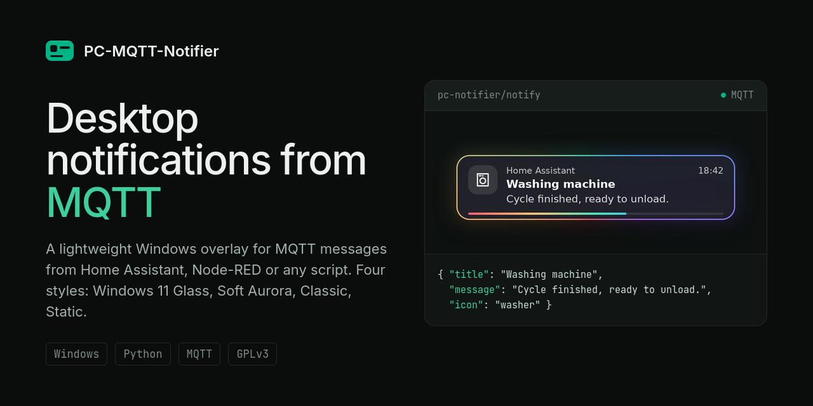
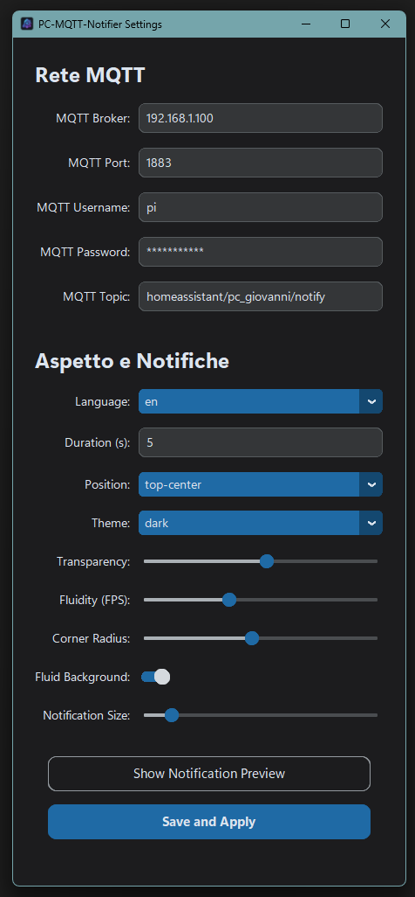

# 🔔 PC-MQTT-Notifier

**Bypass Windows Toast. Own your notifications with a lightweight, highly customizable, fluid overlay connected to MQTT.**

**🇬🇧 English** · [🇮🇹 Italiano](#italiano)

Listen to any **MQTT topic** (from Home Assistant, Node-RED, or custom scripts) and display sleek, non-invasive desktop notifications with animated fluid backgrounds on Windows.

<p align="center">
  <a href="https://github.com/giosci1994/PC-MQTT-Notifier/actions/workflows/build.yml"></a>
  <a href="https://github.com/giosci1994/PC-MQTT-Notifier/releases/latest"></a>
  
  
  <a href="LICENSE"></a>
  <a href="https://buymeacoffee.com/giosci1994u"></a>
</p>

<p align="center">
  
</p>

---

## ✨ Features

- 🌊 **Fluid Background**: Gorgeous animated mesh gradients powered by fast Lissajous curve calculations. Uses 0% CPU in static background mode.
- 🎨 **Highly Customizable**: Change UI scale, opacity/transparency, corner radius, animation FPS, display duration, and screen position (top-center, bottom-right, top-right, bottom-center).
- 🌍 **Native i18n (Bilingual)**: Full built-in English and Italian translations. Easily add new languages by dropping a JSON file into the `locales/` folder.
- ⚙️ **System Tray Native**: Runs quietly in your system tray with single-click settings and instant test previews.
- 🔄 **GitHub Auto-Updater**: Built-in update checker that automatically notifies you and installs the latest `.exe` release in one click.
- 🔌 **Home Assistant & MQTT Ready**: Receives simple JSON payloads from Home Assistant, Node-RED, or any custom MQTT broker.

---

## 📸 Screenshots

<p align="center">
  
  &nbsp;&nbsp;
  
</p>

<p align="center">
  
</p>

---

## 🚀 Installation

### Option 1: Installer (Recommended)
1. Download `PC-MQTT-Notifier-Setup-1.0.0.exe` from the **[Releases](../../releases)** page.
2. Run the installer. It will automatically place the application in your Start Menu and support **1-click auto-updates**.

### Option 2: Portable Executable
1. Download `PC-MQTT-Notifier.exe` from the Releases page.
2. Run it anywhere on your system without installation.

---

## ⚙️ MQTT Payload & Setup

The application subscribes to your specified MQTT topic (default: `homeassistant/pc_giovanni/notify`).

### 📩 JSON Payload Format
Send a JSON payload with a `title` and `message` key:

```json
{
  "title": "Front Door Opened",
  "message": "The main entrance door sensor was triggered at 16:20."
}
```

### 🏠 Home Assistant Automation Example

Add this action to any Home Assistant automation YAML:

```yaml
action: mqtt.publish
data:
  topic: homeassistant/pc_giovanni/notify
  payload: >-
    {
      "title": "Solar Power Peak",
      "message": "Solar panel production exceeded 4.5 kW!"
    }
```

---

## 🛠️ Development & Building from Source

### Prerequisites
- Python 3.10+ installed on Windows.

### 1. Clone & Run
```bash
git clone https://github.com/giosci1994/PC-MQTT-Notifier.git
cd PC-MQTT-Notifier

# Install dependencies
pip install -r requirements.txt

# Run main application
python main.py
```

### 2. Build Executable with PyInstaller
```bash
pyinstaller --noconsole --onefile --icon=icon.ico --name="PC-MQTT-Notifier" main.py
```

### 3. Build Windows Installer with InnoSetup
Compile the `setup.iss` script using **Inno Setup 6**:
```bash
iscc setup.iss
```
This generates `Output/PC-MQTT-Notifier-Setup-1.0.0.exe`.

---

## 🧩 Project Structure

```
PC-MQTT-Notifier/
├── main.py                  # Core application (CTk GUI, MQTT client, pystray, auto-updater)
├── requirements.txt         # Python dependencies
├── config.json              # Saved configuration settings
├── icon.png / icon.ico      # Application icons
├── setup.iss                # InnoSetup installer configuration
├── locales/                 # i18n translation files
│   ├── en.json              # English locale
│   └── it.json              # Italian locale
├── docs/                    # GitHub Pages website & assets
│   ├── index.html           # Arborae-standard landing page
│   ├── css/style.css        # Stylesheet & design system
│   ├── js/main.js           # Scroll reveal & toggle scripts
│   └── social-preview.png   # 1280x640 social preview image
└── .github/
    └── workflows/
        └── build.yml        # CI/CD automated build workflow
```

---

## 🔐 Privacy & Security

- **100% Local Connection**: Connects directly to your local or private MQTT broker. No telemetry or tracking.
- **Auto-Updates**: Update checks strictly poll public GitHub Releases via the official GitHub REST API.

---

## ☕ Support

If PC-MQTT-Notifier is useful to you, you can buy me a coffee.

<a href="https://buymeacoffee.com/giosci1994u"></a>

## 📄 License

Distributed under the **GPLv3 License**. See [`LICENSE`](LICENSE) for more information.

Developed with ❤️ by **[giosci1994](https://github.com/giosci1994)** / **Arborae**.

<br>

---
---

<a id="italiano"></a>

# 🇮🇹 Italiano

**Supera le notifiche native di Windows. Gestisci le tue notifiche con un'overlay fluttuante, leggero e personalizzabile collegato via MQTT.**

Ascolta qualsiasi **topic MQTT** (da Home Assistant, Node-RED o script custom) e mostra notifiche desktop eleganti con sfondi animati a gradiente su Windows.

---

## ✨ Funzionalità

- 🌊 **Sfondo Fluido Animato**: Sfondi animati a gradiente basati sulle curve di Lissajous. Consumo CPU azzerato in modalità statica.
- 🎨 **Altamente Personalizzabile**: Regola la scala dell'interfaccia, la trasparenza, il raggio degli angoli, gli FPS dell'animazione e la posizione sullo schermo (in alto al centro, in basso a destra, ecc.).
- 🌍 **Multilingua Nativo (i18n)**: Traduzione completa in Italiano e Inglese. Aggiungi nuove lingue inserendo un semplice file JSON nella cartella `locales/`.
- ⚙️ **Integrazione System Tray**: Gira silenziosamente nella tray di Windows con menu di impostazioni ed anteprima istantanea.
- 🔄 **Auto-Updater da GitHub**: Sistema integrato di controllo aggiornamenti che ti avvisa ed installa l'ultima versione `.exe` in un click.
- 🔌 **Pronto per Home Assistant & MQTT**: Riceve payload JSON standard da Home Assistant, Node-RED o qualsiasi broker MQTT locale.

---

## ⚙️ Formato Payload MQTT

L'applicazione si iscrive al topic specificato (default: `homeassistant/pc_giovanni/notify`).

### 📩 Esempio Payload JSON
```json
{
  "title": "Porta Principale Aperta",
  "message": "Il sensore dell'ingresso è stato attivato alle 16:20."
}
```

### 🏠 Esempio Automazione Home Assistant
```yaml
action: mqtt.publish
data:
  topic: homeassistant/pc_giovanni/notify
  payload: >-
    {
      "title": "Picco Fotovoltaico",
      "message": "La produzione dei pannelli ha superato 4.5 kW!"
    }
```

---

## 🛠️ Sviluppo & Compilazione

```bash
# Clonazione repository
git clone https://github.com/giosci1994/PC-MQTT-Notifier.git
cd PC-MQTT-Notifier

# Installazione dipendenze
pip install -r requirements.txt

# Avvio applicazione
python main.py

# Compilazione Eseguibile
pyinstaller --noconsole --onefile --icon=icon.ico --name="PC-MQTT-Notifier" main.py
```

Per compilare l'installer Windows `.exe`, usa **Inno Setup 6** sul file `setup.iss`.

---

## ☕ Supporta il progetto

Se PC-MQTT-Notifier ti è utile, puoi offrirmi un caffè.

<a href="https://buymeacoffee.com/giosci1994u"></a>

## 📄 Licenza

Distribuito sotto licenza **GPLv3**. Vedi [`LICENSE`](LICENSE) per ulteriori informazioni.

Sviluppato con ❤️ da **[giosci1994](https://github.com/giosci1994)** / **Arborae**.
