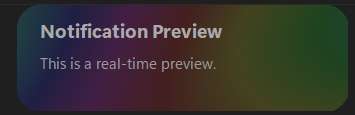
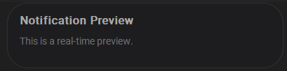
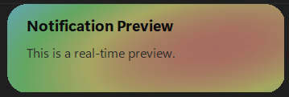

# PC-MQTT-Notifier 🔔


**PC-MQTT-Notifier** is a lightweight, customizable, and non-invasive Windows desktop application that listens to MQTT topics and displays floating notifications (overlays) on your screen. 
It completely bypasses the native Windows Toast Notification system, allowing you to position notifications wherever you want, with rich visual customizations, fluid animations, and real-time i18n support.

*🇮🇹 **PC-MQTT-Notifier** è un'applicazione desktop per Windows leggera, personalizzabile e non invasiva che ascolta topic MQTT e mostra notifiche fluttuanti (overlay) sullo schermo. Ignora completamente il sistema nativo di notifiche Toast di Windows, permettendoti di personalizzare posizionamento, estetica, animazioni fluide e lingua in tempo reale.*

---

## Features / Funzionalità ✨

- 🌍 **Multi-language (i18n)**: Fully translated (English and Italian out of the box). You can easily add new languages by dropping a `.json` file in the `locales/` folder.
- 🎨 **Rich UI Customization**: Adjust notification scale (size), transparency (alpha), and corner radius (from sharp to pill-shaped).
- 🌊 **Fluid Background**: Optional animated "mesh gradient" background with adjustable FPS for a premium, modern look. Falls back to a native-looking box if disabled (0% CPU usage).
- 📍 **Custom Positioning**: Choose where the notification appears (Top Center, Bottom Right, Top Right, Bottom Center).
- 🌓 **Theme Support**: Dark, Light, or System-matched styling.
- ⚙️ **Built-in Settings GUI**: Easily configure MQTT credentials, topics, and UI preferences directly from the app (accessible via System Tray).
- 🚀 **Auto-Startup**: Installer includes an option to start automatically with Windows.

*(IT)*
- 🌍 **Multilingua (i18n)**: Tradotto integralmente (Inglese e Italiano di default). Aggiungi nuove lingue inserendo un file `.json` nella cartella `locales/`.
- 🎨 **Estetica Personalizzabile**: Regola la grandezza della notifica, la trasparenza (alpha) e l'arrotondamento degli angoli (da squadrati a pillola).
- 🌊 **Sfondo Fluido**: Sfondo animato opzionale per un look moderno e premium (con FPS regolabili). Disattivandolo si torna a un look di sistema (utilizzo CPU zero).
- 📍 **Posizionamento Personalizzato**: Scegli dove far apparire la notifica (es. In alto al centro, in basso a destra).
- 🌓 **Supporto Temi**: Tema Chiaro, Scuro o integrato col Sistema.
- ⚙️ **Interfaccia Impostazioni**: Configura credenziali MQTT, topic e UI tramite la comoda interfaccia (accessibile dalla System Tray).
- 🚀 **Avvio Automatico**: L'installer (se usato) include l'opzione per l'avvio automatico con Windows.

---

## Screenshots 📸

### Settings / Impostazioni


### Notifications / Notifiche
| Theme | Fluid Background (Wave) | Static Background (Classic) |
|---|---|---|
| **Dark** |  |  |
| **Light** |  |  |

---

## Installation / Installazione 🚀

### For End Users / Per gli Utenti (Easy Method)
1. Go to the **Releases** tab on GitHub.
2. Download `PC-MQTT-Notifier-Setup.exe` (or the portable zip).
3. Run the application. It will sit quietly in your System Tray (bottom right of your screen).
4. Right-click the bell icon and click **Settings / Impostazioni** to configure your MQTT Broker and UI preferences.
5. *Note: Keep the `locales` folder next to your executable if you are using the portable version!*

*(IT)*
1. Vai nella scheda **Releases** su GitHub.
2. Scarica l'eseguibile (o il file zip portatile).
3. Avvia l'applicazione. Rimarrà in ascolto in background nella System Tray (in basso a destra).
4. Clicca col tasto destro sull'icona della campanella e seleziona **Impostazioni** per configurare MQTT e la grafica.
5. *Nota: Mantieni la cartella `locales` accanto all'eseguibile se usi la versione portatile!*

---

## Home Assistant Integration 🏠
You can use this app to receive notifications from Home Assistant. Send a JSON payload to your configured MQTT topic:

*(IT) Puoi usare quest'app per ricevere notifiche da Home Assistant. Invia un payload JSON al topic MQTT configurato:*

```yaml
service: mqtt.publish
data:
  topic: homeassistant/pc_giovanni/notify
  payload: >
    {
      "title": "Allarme Casa",
      "message": "Qualcuno ha aperto la porta di ingresso!"
    }
```

---

## Contributing Translations / Aggiungere Traduzioni 🌐
Want to use the app in your language? 
1. Copy `locales/en.json` and rename it (e.g. `fr.json`, `es.json`).
2. Translate the strings inside.
3. Restart the app (or open Settings) and your language will magically appear in the dropdown!
4. Feel free to open a Pull Request to add your language to the official repository.

---

## Build from Source / Compilare dal codice sorgente 🛠️

```bash
git clone https://github.com/YOUR_USERNAME/PC-MQTT-Notifier.git
cd PC-MQTT-Notifier
pip install -r requirements.txt
python main.py
```

To build the executable with PyInstaller:
*(IT) Per compilare l'eseguibile:*
```bash
pip install pyinstaller
pyinstaller --noconfirm --windowed --icon=icon.ico --add-data "icon.png;." --add-data "locales;locales" --name "PC-MQTT-Notifier" main.py
```

---
### License
This project is licensed under the GPL-3.0 License - see the `LICENSE` file for details.
